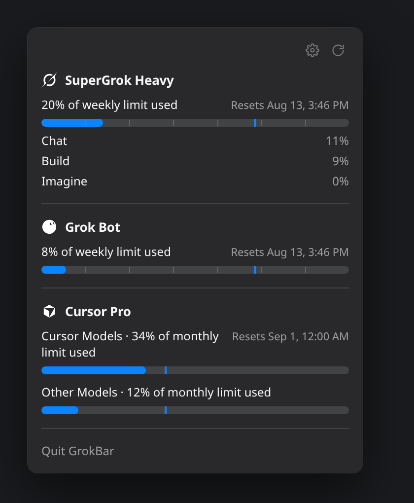
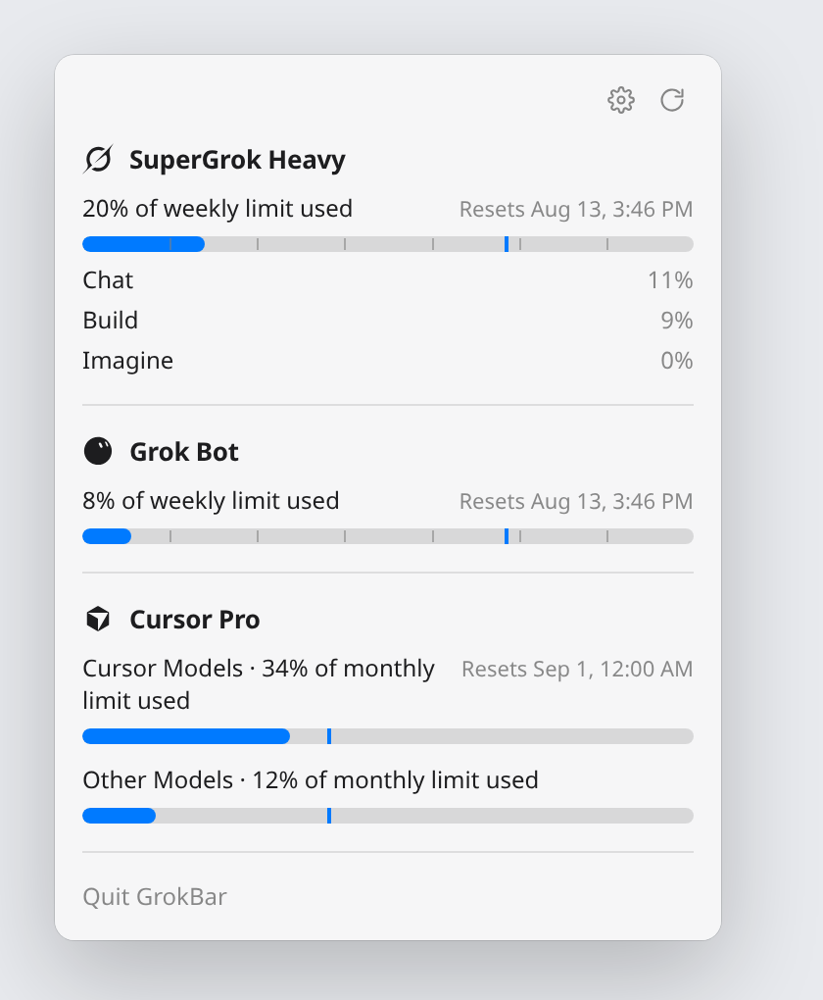
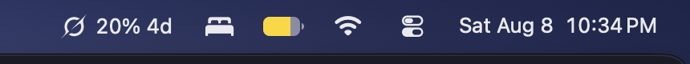

# GrokBar

<p align="center">
  <strong>Grok, Grok Bot, and Cursor usage in the Mac menu bar</strong>
</p>

<p align="center">
  
  
</p>

<p align="center">
  
  
  
</p>

Unofficial menu bar utility. Same information as [Grokbar for Omarchy](https://github.com/pixbroker/grokbar-omarchy): SuperGrok weekly pool, optional Grok Bot weekly pool, optional Cursor monthly pools. Native AppKit status item and SwiftUI popover.

---

## Menu bar

<p align="center">
  
</p>

Each enabled product is icon + percent + reset (`5d` / `12h`):

| Cluster | Meaning |
|---------|---------|
| **Grok mark** | SuperGrok weekly pool used, time until reset |
| **Grok Bot face** | Grok Bot weekly pool used, time until reset |
| **Cursor mark** | Cursor Models %, Other Models %, time until billing reset |

SuperGrok is on by default. Grok Bot and Cursor are off until you enable them in the popover (**gear → Show in Menu Bar**). SuperGrok can be turned off too.

---

## Popover

Click the item for the usage panel: plan, reset countdown, and product split. Same numbers as the Omarchy widget.

- Plan name, weekly or monthly % used, reset date
- Pace marker on the usage bar (where linear usage “should” be)
- SuperGrok product split (Chat, Build, Imagine, Voice, API)
- Cursor Models / Other Models as two monthly bars
- Account name and email (click the plan title)
- Gear for visibility toggles, circular arrow to refresh
- xAI status banner when [status.x.ai](https://status.x.ai/) declares an incident

---

## Requirements

- **macOS 14** or later
- SuperGrok: [Grok Build](https://x.ai/build) signed in (`grok login`) so `~/.grok/auth.json` exists
- Grok Bot / Cursor: Cursor signed in on this Mac, **same account email as Grok**

```bash
grok login   # only if ~/.grok/auth.json is missing
```

---

## Install

```bash
git clone https://github.com/pixbroker/grokbar.git
cd grokbar
bash build.sh
cp -R "build/GrokBar.app" /Applications/
open /Applications/GrokBar.app
```

Xcode (or Xcode-beta) is required. **Launch at Login** is registered on first run. Allow GrokBar under **System Settings → General → Login Items** if macOS asks.

Ad-hoc signed builds: first open via **right-click → Open** if Gatekeeper warns.

---

## Behavior

| Situation | What you see |
|-----------|----------------|
| SuperGrok signed in | Grok cluster with weekly % and countdown |
| Grok Bot enabled, matching Cursor session | Bot cluster with weekly % |
| Cursor enabled, matching Cursor session | Cursor Models %, Other Models %, monthly reset |
| Cursor signed in as a different account | Hidden; popover explains the mismatch |
| Not signed in to Grok | `—` and a setup hint; re-checks about every 2 minutes |
| Network blip | Last good SuperGrok snapshot stays in the menu bar |
| Active xAI incident | `⚠` plus a banner in the popover |

Background refresh is about **every 20 minutes** when healthy, **~5 minutes** during a declared outage, and **~2 minutes** while waiting for setup. Opening the popover refreshes if data is older than **15 minutes**. The countdown ticks locally every minute.

---

## Privacy

| Action | Detail |
|--------|--------|
| **Read** | `~/.grok/auth.json`; Cursor `state.vscdb` / CLI `auth.json` |
| **Write** | May refresh Grok OIDC tokens in `~/.grok/auth.json` |
| **Network** | `auth.x.ai`, `cli-chat-proxy.grok.com`, `api2.cursor.sh` (usage metadata), `status.x.ai/feed.xml` |
| **Not sent** | Chats, code, project files |

No inference or completions — only usage, subscription metadata, and the public status feed.

---

## How it works

1. Load Grok OIDC credentials from `~/.grok/auth.json` (same file as `grok`).
2. Refresh the access token when near expiry (`auth.x.ai/oauth2/token`).
3. Fetch SuperGrok billing (`/v1/billing?format=credits`) plus plan/profile when available.
4. If Grok Bot or Cursor is enabled, load the Cursor session and call `GetCurrentPeriodUsage` / `GetSandUsageStatus` only when the Cursor email matches Grok.
5. Fetch the public xAI status RSS feed.
6. Cache the last good SuperGrok snapshot under Application Support.
7. Register as a login item via `SMAppService`.

---

## License

[MIT](LICENSE)

Not affiliated with xAI or Anysphere. Grok, Grok Bot, and Cursor are property of their owners.
